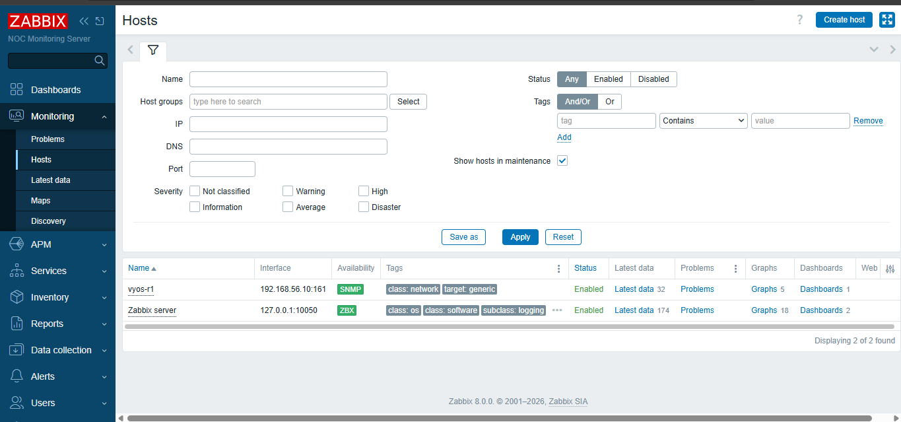

# Network Monitoring Dashboard (NOC-style Lab)

A small Network Operations Centre (NOC) lab. A Zabbix server monitors a VyOS virtual router over SNMP, raises alerts for device-down, high-bandwidth and high-CPU conditions, sends notifications to Telegram, and shows everything on a dashboard.

> **Author:** S.H.Salini Nehara
> **Status:** Completed lab project (SNMPv2c). SNMPv3 is listed under Limitations and Future Work.

---

## 1. Goal

Build the kind of monitoring a NOC engineer uses every day:

- Collect data from a network device with SNMP
- Detect problems with triggers
- Notify the on-call person
- Show device health on one dashboard

## 2. Architecture

```
                 Host-only network 192.168.56.0/24
  ┌───────────────────┐        SNMP (UDP 161)        ┌──────────────────┐
  │  Zabbix Server    │ ───────────────────────────► │  VyOS-R1         │
  │  Ubuntu Server    │ ◄─────── ICMP ping ───────── │  Virtual router  │
  │  192.168.56.101   │                              │  192.168.56.10   │
  └─────────┬─────────┘                              └──────────────────┘
            │ NAT adapter (internet)
            ▼
     Telegram Bot API  ──►  Alert messages on phone
```

| Machine | Platform | Network | IP address |
|---|---|---|---|
| Windows host | Laptop | Host-only | 192.168.56.1 |
| Zabbix server | VirtualBox VM, Ubuntu Server | Host-only (static) + NAT | 192.168.56.101 |
| VyOS-R1 | VirtualBox VM, VyOS 2026.11.18 rolling | Host-only | 192.168.56.10 |

## 3. Tools used

| Area | Tool |
|---|---|
| Virtualization | Oracle VirtualBox |
| Monitoring | Zabbix 8.0 (server, web frontend) |
| Database / web | PostgreSQL, Apache |
| Network device | VyOS (installed to disk) |
| Protocols | SNMPv2c, ICMP, HTTPS (Telegram API) |
| Notifications | Telegram bot (Zabbix webhook media type) |
| Admin | SSH, netplan, chrony, `snmpget`, `pg_dump` |

## 4. What I built

1. **Zabbix server** on Ubuntu with PostgreSQL and Apache, with a static IP set through netplan and time sync through chrony (Asia/Colombo time zone).
2. **VyOS router** installed to disk, with SNMPv2c read-only access and SSH on the management address.
3. **SNMP monitoring** with the *Network Generic Device by SNMP* template. Zabbix discovered 58 items, including all four interfaces.
4. **A custom CPU item** (OID `1.3.6.1.4.1.2021.11.11.0`, idle %) with a JavaScript preprocessing step (`100 - value`) to give CPU usage.
5. **Custom triggers**
   - `High CPU usage on vyos-r1`: `avg(/vyos-r1/cpu.util.snmp,2m)>80`
   - `High traffic on eth0 (lab test)`: `avg(/vyos-r1/net.if.in[ifInOctets.2],3m)>1000000`
6. **Telegram notifications** through a trigger action (severity Warning and above).
7. **NOC Overview dashboard** with four widgets: active alerts, device availability, CPU usage, and eth0 traffic graph.
8. **Backups**: database dump, Zabbix host export (YAML), and VyOS configuration (redacted copies in `configs/`).

## 5. Test plan and results

Each alert was triggered on purpose and checked until it recovered.

| # | Test | How it was triggered | Trigger | Detected | Result |
|---|---|---|---|---|---|
| 1 | Device unreachable | Disabled `eth0` on VyOS (`set interfaces ethernet eth0 disable`) | *Unavailable by ICMP ping* (template) | About 5 to 6 minutes after the outage | Alert raised, then **resolved** after re-enabling the interface |
| 2 | High bandwidth | Ping flood from the Zabbix server: `ping -f -s 1400 192.168.56.10` | *High traffic on eth0 (lab test)* (custom) | About 5 minutes | Alert raised at roughly 2 Mbps, **resolved** after the flood stopped |
| 3 | High CPU | Two `yes > /dev/null &` processes on VyOS | *High CPU usage on vyos-r1* (custom) | About 3 minutes | Alert raised, then **resolved** about 90 seconds after `pkill yes` |

**Note on test 2:** the template's built-in *High bandwidth usage* trigger fires at 90% of link speed for 15 minutes, which is not reachable in a lab with a 1 Gbps virtual link. I created a custom trigger with a 1 Mbps threshold to prove the detection logic. In production the threshold would be set from the real capacity and a baseline.

Notifications were delivered to Telegram when problems were raised.

## 6. Screenshots

### Dashboard


### SNMP host status and collected data



### Device unreachable alert


### High CPU alert


### High bandwidth alert


### Telegram notification


Images are stored in the `screenshots/` folder:

## 7. Problems I solved

| Problem | What I found | Fix |
|---|---|---|
| Zabbix server could not reach the router; ARP requests got no reply | The VyOS interface had lost its IP because VyOS was running in live-ISO mode, so nothing answered ARP. I had also been testing the wrong path (GNS3 VM to VyOS instead of Zabbix server to VyOS). | Re-applied the IP and tested from the Zabbix server |
| VyOS forgot its configuration after restarts | Live-ISO mode does not save changes | Ran `install image` to install VyOS to disk |
| `snmpwalk ... sysDescr` returned "Unknown Object Identifier" | The SNMP MIB files were not installed on the Ubuntu server | Used the numeric OID `1.3.6.1.2.1.1.1.0` (Zabbix itself uses numeric OIDs) |
| Could not log in to the Zabbix web interface | Account was temporarily blocked after failed attempts | Reset the Admin password hash directly in PostgreSQL. A first attempt used `HASH=( ... )` instead of `HASH=$( ... )`, which stored the wrong value. Fixed it and changed the password afterwards. |
| Telegram test returned "chat not found" | I had used the `update_id` instead of `chat.id` from the bot's `getUpdates` output | Used the correct `chat.id`. Test-window macros such as `{EVENT.SOURCE}` also had to be replaced with plain values. |
| `netplan try` reported invalid YAML | A duplicate `version: 2` line and the new interface block were in the wrong place | Rewrote the file and used `netplan try` (automatic rollback) to apply it safely |
| SNMPv3 queries timed out | VyOS logged `error parsing ScopedPDU`, which pointed to a privacy-password mismatch (long commands had been garbled in the console) | Removed SNMPv3 and kept SNMPv2c. Listed as future work. |
| VyOS kept crashing and then hit a kernel panic (`IO-APIC + timer doesn't work`) in GNS3 | The GNS3 VM reported no KVM support. Windows virtualization-based security was holding the hardware virtualization, so VyOS ran in slow software emulation. | Moved VyOS out of GNS3 into its own VirtualBox VM, which boots in about a minute |
| Long commands were corrupted in the console | Console line wrapping | Used SSH for pasting long commands |

## 8. Security and housekeeping

- Default Zabbix `Admin` password changed
- Telegram bot token revoked and replaced after it had been exposed during testing
- Default VyOS password changed
- Static management IP on the monitoring server
- NTP via chrony on the monitoring server
- Backups kept privately: the database dump is **not** in this repository because it contains password hashes and the bot token

## 9. Limitations and future work

- **SNMPv2c** sends the community string in clear text. SNMPv3 (authPriv, SHA/AES) was attempted but not completed, and is the recommended production choice.
- **Lab thresholds**: the bandwidth trigger uses a deliberately low threshold for testing.
- **Single device**: only one router and the server itself are monitored. A next step is adding a Linux host with the Zabbix agent.
- **Time sync**: VyOS has no internet in this lab, so its clock can drift (Zabbix timestamps use the server's clock).
- **Next improvements**: a reusable custom template with threshold macros, trigger dependencies and tags, Syslog collection, and SNMP traps.

## 10. Repository layout

```
Network-Monitoring-Dashboard-NOC-style-lab/
├── README.md
├── configs/
│   ├── vyos-config.txt              (passwords removed, community redacted)
│   └── vyos-r1-host-export.yaml     (community redacted)
├── docs/
│   └── topology.png
└── screenshots/
```

## 11. What I learned

- How SNMP works (agents, communities, OIDs) and the difference between SNMPv2c and SNMPv3
- Agent-based versus agentless monitoring
- How Zabbix hosts, templates, items, triggers and actions fit together
- Layer 2 troubleshooting (ARP) in a virtual network
- Why monitoring thresholds must reflect real capacity
- How nested virtualization and Windows virtualization-based security affect lab design, and how to diagnose it
